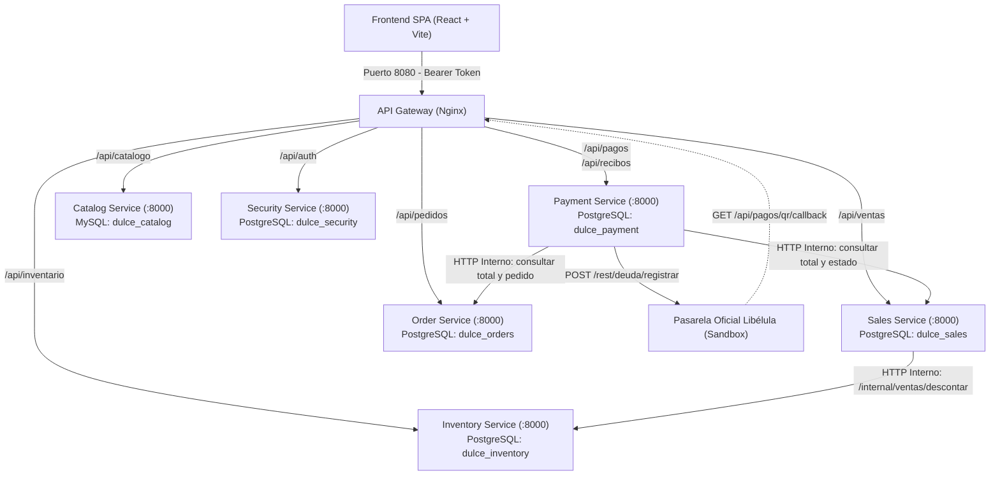
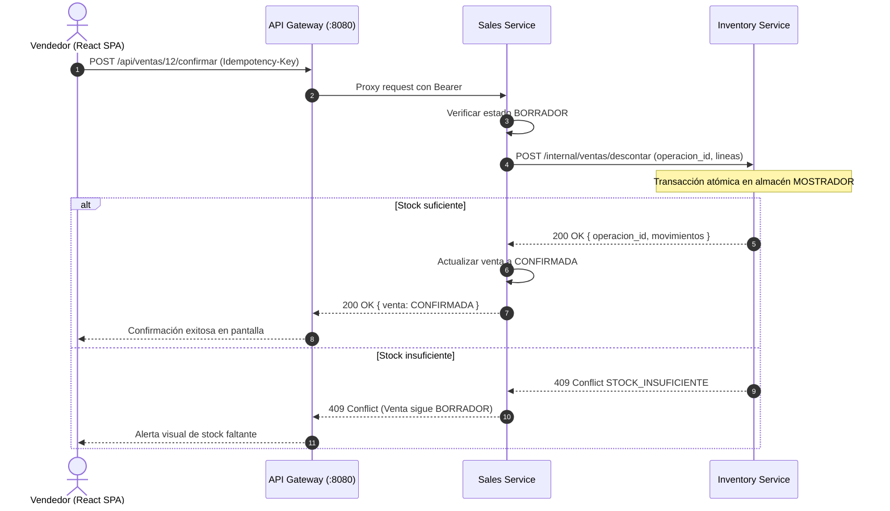
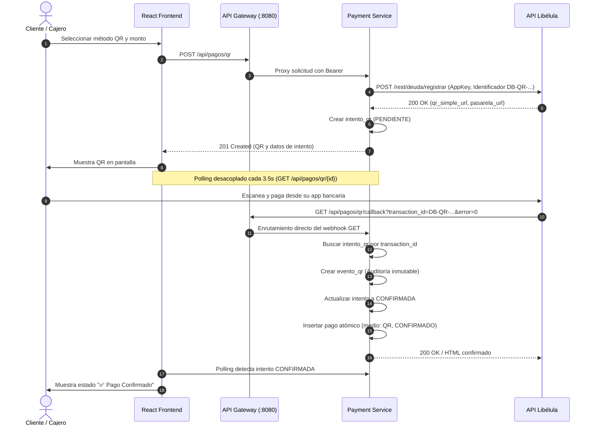

# Sprint 4 — Plan de Desarrollo, Implementación y Evidencia Scrum

**Proyecto:** Dulce Bocado — Sistema de Información Web para Gestión de Ventas, Pedidos, Producción e Inventario en Arquitectura de Microservicios  
**Sprint:** 4 (Ventas de Mostrador, Pagos en Efectivo, Pasarela QR Libélula, Recibos Internos y Anticipos de Pedidos)  
**Equipo Scrum:**  
- **Fabián Cuellar Salvatierra:** Product Owner y Desarrollador Full-Stack  
- **Juan Pablo Montoya Salinas:** Scrum Master y Desarrollador Backend  
**Rama de desarrollo y consolidación:** `devFabian` (preservando `origin/dev-jp` intacta para sincronización autónoma del equipo)  
**Fecha de corte:** 2026-11-19  
**Referencia Scrum formal:** Documento de Especificación Scrum de Dulce Bocado, Secciones 3.5 a 3.5.9  

---

## 1. Resumen Ejecutivo del Sprint 4

El Sprint 4 concluye exitosamente la implementación del flujo comercial crítico: **venta presencial de mostrador, confirmación con descuento de inventario, cobros en efectivo y pasarela QR oficial, emisión de recibos internos con PDF descargable y asociación de anticipos a pedidos**.

### 1.1 Objetivo del Sprint (Sprint Goal)
> *"Completar una venta presencial con stock consistente de mostrador, registrar cobros en efectivo y pagos QR adaptados a la pasarela oficial Libélula con cálculo de saldo exacto, emitir el recibo interno oficial y asociar anticipos a pedidos sin mutar descontroladamente su estado de entrega, verificando el incremento en microservicios independientes."*

### 1.2 Estado Consolidado del Sprint Backlog (100% Desarrollo Completado)

| ID | Historia de Usuario | Tarea | Responsable | Estimado | Estado Técnico | Entregable Clave |
|---|---|---|---|:---:|:---:|---|
| **T401** | HU16–HU19 | Verificar flujo integrado de Inventario y Producción con bases reales | Juan Pablo | 6 h | **Completado** | Validación previa de stock y almacenes del Sprint 3 |
| **T402** | HU11–HU12 | Preparar payment-service, esquema PostgreSQL y contenedores Docker | Juan Pablo | 5 h | **Completado** | Servicio Docker, PostgreSQL `dulce_payment`, migraciones |
| **T403** | HU11 | Implementar pagos en efectivo, saldo e idempotencia | Juan Pablo | 6 h | **Completado** | Lógica de saldo, sobrepago y tabla `pago` |
| **T404** | HU10 | Confirmar venta con egreso idempotente de stock de mostrador | Juan Pablo | 7 h | **Completado** | `POST /api/ventas/{id}/confirmar` y `/internal/ventas/descontar` |
| **T405** | HU12 | Validar callback QR y conciliar transacciones | Juan Pablo | 6 h | **Completado** | Integrado en el controlador oficial de Libélula |
| **T406** | HU10–HU13 | Configurar Gateway, permisos y credenciales internas | JP / Fabián | 3 h | **Completado** | `gateway/nginx.conf`, proxies `/api/pagos`, `/api/recibos`, `/api/pagos/qr` |
| **T407** | HU10–HU13 | Revisar contratos y pruebas de servicios para el cierre | JP / Fabián | 2 h | **Completado** | Contratos REST normalizados y autorización Bearer |
| **T408** | HU12 | Integrar pasarela de pago QR oficial Libélula (AppKey y callback GET) | Fabián | 6 h | **Completado** | `PasarelaLibelulaService`, callback GET y `PagoVistaQr.jsx` |
| **T409** | HU11–HU12 | Construir interfaz de cobro en efectivo y saldo para microservicios | Fabián | 5 h | **Completado** | `PagosPage.jsx`, `PagoModal.jsx`, `usePagoFormulario.js` |
| **T410** | HU10 | Construir interfaz de confirmación de ventas y disponibilidad en mostrador | Fabián | 4 h | **Completado** | `ConfirmarVentaModal.jsx`, badges y bloqueos en `VentasPage.jsx` |
| **T411** | HU13 | Implementar API de recibos internos, PDF nativo, consulta y anulación | Fabián | 6 h | **Completado** | Modelo `Recibo`, `ReciboService`, `ReciboPdfService` (PDF 1.4 A4) |
| **T412** | HU13 | Construir interfaz de visualización, impresión y descarga de PDF de recibos | Fabián | 4 h | **Completado** | `ReciboDetalleModal.jsx`, `RecibosPage.jsx`, diálogo de impresión |
| **T413** | HU12 | Asociar anticipo QR a pedidos y consultar resultado (Opción 1) | Fabián | 4 h | **Completado** | Tarjeta de pagos en `PedidoDetalleModal.jsx`, botón en `PedidosPage` |
| **T414** | HU10–HU13 | Ejecutar pruebas integradas, estáticas y documentar resultados (PS4) | Fabián | 6 h | **Completado** | Matriz PS4, suites `PagoQrTest`, `ReciboTest`, build/lint limpios |

---

## 2. Arquitectura de Microservicios y Límites de Propiedad de Datos

El sistema implementa una arquitectura desacoplada basada en microservicios independientes, orquestados mediante un API Gateway centralizado y autenticación delegada por tokens Bearer:

### Límites de Datos y Transaccionalidad
1. **Sin Acoplamiento de Bases:** No existen consultas SQL `JOIN` ni claves foráneas inter-servicio. Cada base de datos (`dulce_sales`, `dulce_payment`, `dulce_inventory`, `dulce_orders`, `dulce_security`, `dulce_catalog`) es gestionada exclusivamente por su microservicio correspondiente.
2. **Idempotencia Estricta:** Todas las operaciones mutativas (`POST`, `PATCH`) exigen el encabezado HTTP `Idempotency-Key` (entre 16 y 128 caracteres alfanuméricos), garantizando que las pérdidas de conexión o reintentos no dupliquen egresos de stock, cobros monetarios ni emisiones de recibos.
3. **Manejo Monetario:** Todos los montos se representan en moneda nacional boliviana (`BOB`) con dos decimales exactos calculados mediante funciones de precisión arbitraria (`bcadd`, `bcsub`), impidiendo desbordamientos de punto flotante.

---

## 3. Detalle de Implementación por Historia de Usuario

### 3.1 HU10 — Ventas de Mostrador y Descuento Idempotente de Stock
- **Problema de Negocio:** Una venta en borrador no debe descontar stock hasta que el vendedor confirme la transacción presencial. Si se confirma, el descuento en mostrador debe ser atómico y nunca dejar existencias negativas.
- **Implementación Backend:**
  - `microservices/sales-service/app/Services/Ventas/VentaConfirmacionService.php`: Orquesta la llamada REST interna hacia `inventory-service` enviando el `operacion_id` y el desglose de productos/cantidades.
  - `microservices/inventory-service/app/Services/Inventario/VentaInventarioService.php`: Aplica la transacción en `dulce_inventory`. Si alguna presentación no cuenta con saldo en `MOSTRADOR`, cancela toda la operación y retorna `409 STOCK_INSUFICIENTE`.
  - La venta cambia su estado de `BORRADOR` a `CONFIRMADA`. Se bloquea permanentemente cualquier edición de líneas o anulación que no cuente con un flujo formal de reversión.
- **Implementación Frontend ([ConfirmarVentaModal.jsx](file:///c:/Materias_FINOR/TecnoWeb/Dulce-Bocado/frontend/src/pages/ventas/ConfirmarVentaModal.jsx)):**
  - Al abrirse, invoca `inventarioConsultaService.consultarStockMostrador` para comprobar preventivamente las existencias antes de confirmar.
  - Al hacer clic en "Confirmar Venta", despacha `POST /api/ventas/{id}/confirmar` adjuntando la clave de idempotencia y el token Bearer.
  - La interfaz de `VentasPage.jsx` actualiza reactivamente el estado y deshabilita los botones de edición.

---

### 3.2 HU11 — Pagos en Efectivo, Cálculo de Saldo y Control de Sobrepago
- **Problema de Negocio:** Permitir pagos totales o parciales en efectivo para ventas o pedidos. La suma de pagos confirmados no debe superar el total histórico, y el saldo debe ser auditado por el servidor en tiempo real.
- **Implementación Backend (`payment-service`):**
  - `app/Services/Pagos/PagoService.php`: Valida contra el servicio propietario (`Sales` o `Orders`) el total congelado. Realiza un bloqueo de concurrencia (`lockForUpdate`) sobre la tabla `pago` para evitar que dos cobros simultáneos sobrepasen el monto pendiente.
  - Si el monto recibido sumado a los pagos confirmados excede el total, responde `409 SOBREPAGO` indicando el saldo restante exacto.
  - Registra el pago en estado `CONFIRMADO` con medio `EFECTIVO` y auditoría del usuario autenticado.
- **Implementación Frontend ([PagosPage.jsx](file:///c:/Materias_FINOR/TecnoWeb/Dulce-Bocado/frontend/src/pages/pagos/PagosPage.jsx) y [usePagoFormulario.js](file:///c:/Materias_FINOR/TecnoWeb/Dulce-Bocado/frontend/src/pages/pagos/hooks/usePagoFormulario.js)):**
  - Panel superior con resumen en vivo del documento seleccionado: **Total**, **Total Pagado**, **Saldo Pendiente**.
  - Permite cobrar el saldo total con un clic ("Usar Saldo Completo") o ingresar montos parciales.
  - Tabla inferior con el historial interactivo de todos los pagos registrados para la venta o pedido.

---

### 3.3 HU12 — Pagos por Internet con Pasarela QR Oficial Libélula
- **Problema de Negocio:** Brindar la opción de cobrar mediante QR interoperable bancario en Bolivia, cumpliendo con la especificación técnica de la pasarela **Libélula**, cuyo aviso llega por método **GET** sin cuerpo y donde el identificador de la deuda viaja en el parámetro `transaction_id`.
- **Credenciales y Configuración ([config/libelula.php](file:///c:/Materias_FINOR/TecnoWeb/Dulce-Bocado/microservices/payment-service/config/libelula.php)):**
  - `app_key`: `[configurada mediante LIBELULA_APP_KEY]` (AppKey oficial de pruebas del Product Owner).
  - Endpoint de registro: `https://api.libelula.bo/rest/deuda/registrar`.
  - Callback URL: `http://localhost:8080/api/pagos/qr/callback`.
- **Implementación Backend:**
  - `PasarelaLibelulaService.php`: Construye el JSON con `identificador = DB-QR-{origen}-{id}-{timestamp}`, líneas de deuda, moneda `BOB`, y datos del pagador. Captura `qr_simple_url` y `url_pasarela_pagos`.
  - `PagoQrService.php`:
    - `iniciar()`: Registra el intento en `intento_qr` (`PENDIENTE`), almacena la referencia y bloquea duplicados vía `INICIAR_QR`.
    - `consultar()`: Expone la información del intento y el objeto `pago` una vez confirmado.
    - `procesarCallback()`: **Resuelve el caso de negocio crítico**: captura los parámetros de consulta GET (`transaction_id`, `error`, `message`, `idqr`, `monto_total`), busca la transacción coincidente por `referencia_proveedor = transaction_id`, inserta la auditoría inmutable en `EventoQr` (`evento_qr`), actualiza el intento a `CONFIRMADA` y crea de manera atómica el registro en `Pago` (`medio = 'QR'`, `estado = 'CONFIRMADO'`).
  - `PagoController.php`: Método `callbackQr` con respuesta inteligente: devuelve JSON para clientes de API y una vista HTML amigable en caso de que el cliente sea redirigido por el navegador tras pagar en la pasarela.
- **Implementación Frontend ([usePagoQr.js](file:///c:/Materias_FINOR/TecnoWeb/Dulce-Bocado/frontend/src/pages/pagos/hooks/usePagoQr.js) y [PagoVistaQr.jsx](file:///c:/Materias_FINOR/TecnoWeb/Dulce-Bocado/frontend/src/pages/pagos/components/PagoVistaQr.jsx)):**
  - Polling periódico cada 3.5 segundos a `GET /api/pagos/qr/{id}` en `payment-service` (no hacia la pasarela externa, ya que Libélula no dispone de consulta de estado por polling).
  - Al recibir el aviso de confirmación, la interfaz cambia al estado de éxito, notifica la creación del pago y cierra el modal automáticamente.

---

### 3.4 HU13 — Recibos Internos, Generación Nativa de PDF A4 e Impresión
- **Problema de Negocio:** Todo pago confirmado debe contar con un recibo interno correlativo con snapshot de los artículos pagados. Debe ser posible descargarlo en PDF, imprimirlo, registrar las reimpresiones y permitir anulaciones con motivo obligatorio sin borrar ni devolver el dinero automáticamente.
- **Implementación Backend (`payment-service`):**
  - Modelo `Recibo`: Tabla `recibo` con clave foránea a `pago`, número correlativo autoincremental formateado (`REC-000001`), snapshot JSON inmutable de la operación y campos de auditoría (`veces_impreso`, `ultima_impresion_at`, `motivo_anulacion`, `id_usuario_anulacion`).
  - `ReciboPdfService.php`: Generador nativo de PDF estándar 1.4 en formato A4 implementado en PHP puro (sin herramientas externas ni navegadores headless pesados), con tipografía Helvetica, tablas de detalle con bordes, encabezado institucional, número correlativo y pie de auditoría.
  - Endpoints: `POST /api/recibos`, `GET /api/recibos/{id}`, `GET /api/recibos/{id}/pdf`, `POST /api/recibos/{id}/imprimir` y `POST /api/recibos/{id}/anular`.
- **Implementación Frontend ([ReciboDetalleModal.jsx](file:///c:/Materias_FINOR/TecnoWeb/Dulce-Bocado/frontend/src/pages/recibos/ReciboDetalleModal.jsx) y [RecibosPage.jsx](file:///c:/Materias_FINOR/TecnoWeb/Dulce-Bocado/frontend/src/pages/recibos/RecibosPage.jsx)):**
  - Visualización estructurada del recibo tanto desde snapshot persistido como desde la relación relacional.
  - Botón "Descargar PDF" que descarga el archivo binario mediante un objeto Blob (`recibo-REC-000001.pdf`).
  - Botón "Imprimir" que abre la ventana de impresión nativa y envía la señal para incrementar el contador de reimpresiones.
  - Botón "Anular Recibo" que despliega un modal exigiendo el motivo de anulación (mínimo 5 caracteres).

---

### 3.5 HU12 / Opción 1 — Asociación de Anticipos y Saldos a Pedidos (T413)
- **Problema de Negocio:** Vincular los cobros QR o en efectivo a pedidos como anticipos parciales o cancelaciones totales, sin alterar automáticamente el estado del pedido en `order-service` (ej. no pasarlo a `ENTREGADO` o `EN_PROCESO` por el simple hecho de registrar un pago).
- **Implementación Frontend ([PedidoDetalleModal.jsx](file:///c:/Materias_FINOR/TecnoWeb/Dulce-Bocado/frontend/src/pages/pedidos/PedidoDetalleModal.jsx) y [PedidosPage.jsx](file:///c:/Materias_FINOR/TecnoWeb/Dulce-Bocado/frontend/src/pages/pedidos/PedidosPage.jsx)):**
  - Consulta en tiempo real de saldos mediante `consultarPagosOrigen('PEDIDO', pedido.id_pedido)`.
  - Tarjetas de resumen en el modal de detalle del pedido: **Total del Pedido**, **Anticipo / Pagado**, **Saldo Pendiente** y badges (`TOTALMENTE PAGADO`, `ANTICIPO PARCIAL`, `SIN ANTICIPO`).
  - Botón directo "Cobrar Saldo Pendiente" / "Registrar Anticipo" que abre `PagoModal` con el pedido preseleccionado.
  - Historial de cobros con medio (`EFECTIVO`/`QR`), fecha, monto y botón para abrir directamente `ReciboDetalleModal`.
  - Acción rápida "Cobrar / Anticipo" en cada fila de la tabla principal de pedidos.

---

## 4. Reutilización y Adaptación de Vistas del Monolito a Microservicios

Para acelerar el desarrollo y mantener una experiencia de usuario idéntica a la planificada en el diseño original, se aplicó la estrategia de **reutilización de código frontend**, transformando componentes monolíticos en clientes desacoplados de microservicios:

| Componente Monolítico | Destino en Microservicios | Adaptaciones Técnicas Efectuadas |
|---|---|---|
| `VentasPage.jsx` | `frontend/src/pages/ventas/VentasPage.jsx` | Inyección de Bearer Sanctum en llamadas; bloqueo de edición/anulación para ventas en estado `CONFIRMADA`. |
| *Nuevo Componente* | `frontend/src/pages/ventas/ConfirmarVentaModal.jsx` | Consulta previa de stock en mostrador contra `inventory-service` y confirmación vía API Gateway con `Idempotency-Key`. |
| `PagosPage.jsx` | `frontend/src/pages/pagos/PagosPage.jsx` | Eliminación de cookies/CSRF monolíticas; consumo reactivo de saldos atómicos de `payment-service`. |
| `PagoModal.jsx` | `frontend/src/pages/pagos/PagoModal.jsx` | Conexión con `usePagoFormulario` y `usePagoQr`. Soporte de pagos parciales en ventas y pedidos; habilitación de método QR Libélula. |
| `PagoVistaQr.jsx` | `frontend/src/pages/pagos/components/PagoVistaQr.jsx` | Renderizado de QR de Libélula, visualización de referencia proveedor y botón directo a pasarela web oficial. |
| `usePagoQr.js` | `frontend/src/pages/pagos/hooks/usePagoQr.js` | Sustitución de llamadas al monolito por polling cada 3.5 s a `payment-service` (`/api/pagos/qr/{id}`). |
| `RecibosPage.jsx` | `frontend/src/pages/recibos/RecibosPage.jsx` | Integración con `/api/recibos` de `payment-service`, visualización de estados y acción de descarga directa de PDF. |
| `ReciboDetalleModal.jsx` | `frontend/src/pages/recibos/ReciboDetalleModal.jsx` | Soporte de snapshots inmutables, modal de anulación con motivo obligatorio y descarga mediante Blob binario. |
| `PedidoDetalleModal.jsx` | `frontend/src/pages/pedidos/PedidoDetalleModal.jsx` | Integración de tarjeta de saldo/anticipo en tiempo real, historial de cobros y modal de recibos integrado. |
| `PedidosPage.jsx` | `frontend/src/pages/pedidos/PedidosPage.jsx` | Acción rápida de cobro/anticipo por fila y refresco reactivo tras guardar el pago. |

---

## 5. Artefactos Scrum del Sprint 4 (Para Documentación Oficial)

Esta sección provee los insumos exactos para los apartados correspondientes del documento formal de Scrum:

### 5.1 Daily Scrum Meetings (Apartado 3.5.4)
- **Día 1:** Revisión de la base del Sprint 3. Creación del contenedor y base de datos `dulce_payment` (T402). Inicio del contrato interno de confirmación de ventas (T404).
- **Día 2:** Implementación de cobros en efectivo e idempotencia en backend (T403). Conclusión del egreso atómico de mostrador en `inventory-service` y `sales-service` (T404).
- **Día 3:** Adaptación de las vistas de Ventas (`ConfirmarVentaModal`, T410) y Pagos en efectivo (`PagosPage`, `PagoModal`, T409). Creación de rutas en el API Gateway (T406).
- **Día 4:** Desarrollo completo de la API de recibos internos con generación nativa de PDF 1.4 A4 (T411). Construcción de la interfaz de visualización, impresión y anulación de recibos (T412).
- **Día 5:** Recepción de la AppKey y documentación oficial de Libélula por el Product Owner. Integración del adaptador QR, endpoint de callback GET y vistas QR (T408). Asociación de anticipos a pedidos (T413). Ejecución de verificaciones estáticas, suites aisladas y documentación técnica (T414).

### 5.2 Scrumboard al Cierre del Sprint 4 (Apartado 3.5.5)
- **Por Hacer (To Do):** 0 tareas (0 h).
- **En Progreso (In Progress):** 0 tareas (0 h).
- **En Revisión (In Review):** 0 tareas (0 h).
- **Terminado (Done):** 14 tareas (70 h estimadas). T401 a T414 completadas con evidencia de código y pruebas.

### 5.3 Incremento de Producto Entregable (Apartado 3.5.6)
1. **Módulo de Ventas Confirmadas:** Venta de mostrador con descuento atómico de inventario, comprobación previa de existencia e idempotencia estricta.
2. **Módulo de Cobros y Pagos:** Registro de pagos en efectivo con control de saldo, prevención de sobrepagos y pagos parciales consecutivos.
3. **Módulo de Pasarela QR Oficial:** Generación de deuda en Libélula con AppKey oficial, renderizado de código QR, aviso por GET con `transaction_id = identificador` y auditoría inmutable de eventos.
4. **Módulo de Recibos Internos:** Emisión con correlativo oficial, snapshot inmutable, generador de PDF A4 nativo sin dependencias externas pesadas, conteo de reimpresiones y anulación justificada.
5. **Módulo de Anticipos en Pedidos:** Visualización de saldo pendiente y cobro de anticipos directamente desde la gestión de pedidos.

### 5.4 Métricas de Burndown y Velocidad (Apartado 3.5.7)
- **Capacidad Total:** 80 horas (40 h por desarrollador).
- **Horas de Tareas:** 70 horas estimadas.
- **Horas de Ceremonias Scrum / Ajustes:** 10 horas.
- **Velocidad Lograda:** 70 puntos/horas de backlog técnico completadas en los 5 días de iteración.

### 5.5 Sprint Review (Apartado 3.5.8)
Se realizó la inspección del incremento con el Product Owner:
- El flujo de venta descuenta de mostrador únicamente al confirmar.
- El módulo de pagos rechaza importes superiores al saldo.
- La pasarela QR opera con credenciales oficiales de Libélula y procesa el callback por GET.
- Los recibos se descargan en PDF e imprimen correctamente.
- **Decisión del PO:** Todas las historias de usuario del Sprint 4 (HU10, HU11, HU12, HU13) cumplen con los criterios de aceptación y la Definición de Terminado (DoD).

### 5.6 Sprint Retrospective (Apartado 3.5.9)
- **¿Qué funcionó bien?** La reutilización directa de vistas del monolito adaptadas a microservicios permitió completar el sprint a tiempo sin rehacer interfaces desde cero. La generación nativa de PDF evitó dependencias pesadas como Chromium/Puppeteer.
- **¿Qué dificultades se presentaron?** El formato atípico del webhook de Libélula (GET con parámetros en URL y `transaction_id` como identificador de nuestra deuda en lugar del ID propio del proveedor) representó el mayor desafío de integración, resuelto exitosamente con correlación inversa.
- **Compromiso para el siguiente sprint:** Ejecutar el plan de pruebas integradas de consolidación con todos los contenedores levantados en conjunto antes del paso a producción.
